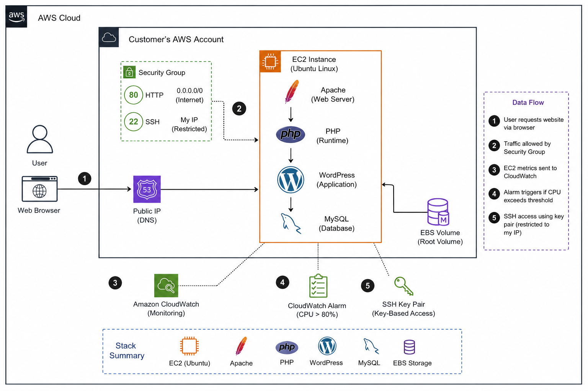

# Migrating a Legacy Application to AWS

## Project overview

This project documents a **rehost (lift-and-shift) migration** of a traditional LAMP/WordPress workload to AWS.

I provisioned an Ubuntu EC2 instance, installed Apache, PHP, MySQL, and WordPress, secured administrative access, validated application and database functionality, reviewed logs and system health, configured CloudWatch monitoring, and documented resource cleanup.

**Lifecycle:** Provision → Configure → Secure → Deploy → Validate → Monitor → Clean Up

## Architecture



The lab used a single EC2 instance as the migration baseline:

- **Amazon EC2** — compute
- **Ubuntu Linux** — operating system
- **Apache** — web server
- **PHP** — application runtime
- **WordPress** — application
- **MySQL** — database
- **Amazon EBS** — persistent block storage
- **Security Groups** — network filtering
- **Amazon CloudWatch** — infrastructure monitoring

This is intentionally a simple learning architecture, not a production reference design.

## 1. Provision EC2 and restrict access

I launched an Ubuntu EC2 instance and attached an EBS root volume. The security group allowed HTTP from the internet and restricted SSH to my public IP.

```text
HTTP  TCP/80  0.0.0.0/0
SSH   TCP/22  My public IP
```


## 2. Connect with SSH and patch the server

```bash
ssh -i "legacy-migration-key.pem" ubuntu@EC2_PUBLIC_IP
sudo apt update
sudo apt upgrade -y
```


## 3. Install and validate the web stack

I installed Apache, PHP, and MySQL, then validated each service before moving on.

```bash
sudo apt install apache2 -y
sudo apt install php libapache2-mod-php php-mysql -y
sudo apt install mysql-server -y
```


## 4. Configure the WordPress database

I created a dedicated database and application account instead of using the MySQL root account.

```sql
CREATE DATABASE wordpress_db;
CREATE USER 'wordpress_user'@'localhost' IDENTIFIED BY '<REDACTED>';
GRANT ALL PRIVILEGES ON wordpress_db.* TO 'wordpress_user'@'localhost';
FLUSH PRIVILEGES;
```


## 5. Deploy WordPress

I downloaded WordPress, copied the application into Apache's document root, configured ownership and permissions, and connected it to MySQL through `wp-config.php`.

```bash
wget https://wordpress.org/latest.tar.gz
tar -xvzf latest.tar.gz
sudo cp -r wordpress/. /var/www/html/
sudo chown -R www-data:www-data /var/www/html
sudo find /var/www/html -type d -exec chmod 755 {} \;
sudo find /var/www/html -type f -exec chmod 644 {} \;
```

I then completed the WordPress installer and verified the application could persist data in MySQL.


## 6. Validate operations

I checked application response, logs, resources, and service state rather than relying only on the website loading.

```bash
curl -I http://localhost
sudo tail -n 20 /var/log/apache2/access.log
sudo tail -n 20 /var/log/apache2/error.log
free -h
df -h
systemctl is-active apache2
systemctl is-active mysql
```


## 7. Security review

Security checks included:

- SSH restricted to my public IP.
- MySQL port 3306 was not exposed publicly.
- A troubleshooting credential that became visible was treated as exposed and rotated.
- `wp-config.php` permissions were restricted after configuration.
- Listening ports were reviewed and compared with AWS security-group rules.

This lab demonstrates the importance of validating both **cloud controls** and **guest operating-system controls**.

## 8. Monitoring and alerting

I reviewed EC2 metrics in CloudWatch and created a CPU-utilization alarm.


A key takeaway from the project was:

> Healthy EC2 infrastructure does not automatically mean the application is healthy.

CloudWatch metrics should be combined with service-level and application-level checks.

## 9. Cleanup

After completing the lab, I removed temporary AWS resources and verified that the environment was no longer generating unnecessary charges.

Cleanup should include checking:

- EC2 instances
- EBS volumes
- Elastic IP addresses
- Load balancers
- CloudFormation stacks
- VPC/NAT resources created specifically for the lab

## Skills demonstrated

- AWS EC2 and EBS
- Linux administration
- Apache / PHP / MySQL
- WordPress deployment
- Security groups and SSH hardening
- SQL database configuration
- CloudWatch monitoring
- Log review and troubleshooting
- Resource lifecycle and cost awareness

## Production improvements

A production redesign would separate responsibilities and add controls such as:

- Application Load Balancer
- Auto Scaling
- Amazon RDS for the database
- private subnets for application/database tiers
- TLS with ACM
- AWS WAF where appropriate
- centralized logging and alerting
- Secrets Manager or Parameter Store
- backups and tested recovery procedures
- Infrastructure as Code
