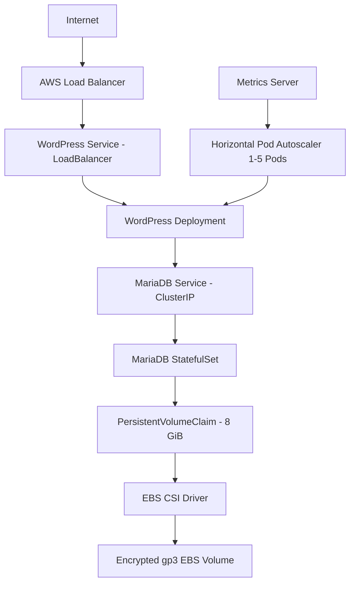

# Project 02 — Deploying Microservices on Amazon EKS

## Status

**Completed.** I built and validated a containerized WordPress application on Amazon EKS using Helm, persistent Amazon EBS storage, Kubernetes Metrics Server, and a CPU-based Horizontal Pod Autoscaler (HPA).

## What I Built

I deployed a two-tier application on EKS:

- **WordPress** as a Kubernetes Deployment
- **MariaDB** as a StatefulSet
- **AWS Load Balancer** through a Kubernetes `LoadBalancer` Service
- **Amazon EBS gp3** persistent storage for MariaDB through the EBS CSI driver
- **Metrics Server** for Kubernetes CPU and memory metrics
- **HPA** configured to scale WordPress from 1 to 5 replicas at 50% average CPU
- **Helm** to package, deploy, and upgrade the application

## Architecture



## Technology Stack

| Layer | Technology |
|---|---|
| Cloud | AWS |
| Kubernetes | Amazon EKS 1.36 |
| Package management | Helm |
| Application | WordPress 7.1.4 |
| Database | MariaDB 12.3.3 |
| Persistent storage | Amazon EBS gp3 / EBS CSI |
| Metrics | Kubernetes Metrics Server |
| Autoscaling | Horizontal Pod Autoscaler |
| Load testing | BusyBox / wget |
| CLI tooling | AWS CLI, eksctl, kubectl, Helm |

## Final Validation

The completed environment reached the following state:

| Validation | Result |
|---|---|
| EKS worker nodes | 2 nodes Ready |
| WordPress | 1/1 Running at steady state |
| MariaDB | 1/1 Running |
| Helm release | Deployed |
| MariaDB PVC | Bound, 8 GiB, gp3 |
| WordPress exposure | AWS Load Balancer |
| Metrics Server | CPU and memory metrics returned successfully |
| HPA | 50% CPU target, min 1, max 5 |
| Scale-out test | 1 → 5 WordPress replicas |
| Scale-down test | 5 → 1 WordPress replica |

## Metrics Server Validation

I verified that Metrics Server was collecting live CPU and memory usage from both EKS worker nodes.


This was an important prerequisite for HPA because Kubernetes needs resource metrics before it can make CPU-based scaling decisions.

## Helm Validation

Before deploying upgrades, I linted the chart to catch YAML and Helm-template issues.


Result:

```text
1 chart(s) linted, 0 chart(s) failed
```

## Persistent Storage

MariaDB uses a StatefulSet and an 8 GiB PersistentVolumeClaim backed by an encrypted `gp3` EBS volume. I created a StorageClass using the EBS CSI driver with:

- `ebs.csi.aws.com`
- `gp3`
- encryption enabled
- `WaitForFirstConsumer`
- volume expansion enabled

This allows the database pod to be recreated without losing its database volume.

## Horizontal Pod Autoscaling

The WordPress Deployment uses CPU requests so the HPA can calculate utilization correctly.

Final HPA configuration:

- Minimum replicas: **1**
- Maximum replicas: **5**
- CPU target: **50%**
- Scale-down stabilization: **60 seconds**

During the successful load test, CPU exceeded the target and Kubernetes scaled WordPress from **1 pod to 5 pods**. After the load generator was removed, CPU returned to normal and Kubernetes automatically scaled the Deployment back to **1 replica**.


The screenshot captures the full scale-down sequence after CPU fell from more than 250% of the configured request to low single digits.

## Troubleshooting and Engineering Lessons

This project included several failures that required real troubleshooting rather than a clean scripted deployment.

### 1. Managed Node Group Failed During the First Attempt

The original node group used an EC2 instance type that was not eligible under the account's Free Tier restrictions. The EKS control plane became `ACTIVE`, but the managed node-group CloudFormation stack rolled back and `kubectl get nodes` returned no worker nodes.

I used:

```bash
aws eks describe-nodegroup
aws cloudformation describe-stacks
aws cloudformation describe-stack-events
kubectl get nodes -o wide
```

to separate control-plane health from worker-node health.

### 2. Git Bash Rewrote /bin/sh

When I created the load generator inline from Git Bash, MSYS converted:

```text
/bin/sh
```

into a Windows path similar to:

```text
C:/Program Files/Git/usr/bin/sh
```

The Linux container could not execute it and entered `StartError`.

I fixed this by defining the load generator as a Kubernetes YAML manifest instead of passing `/bin/sh` through the Git Bash command line.

### 3. WordPress Was OOMKilled Under Extreme Load

My first load test used 100 concurrent infinite request loops. HPA successfully reacted to the CPU spike, but WordPress exceeded its original 512 MiB memory limit. Kubernetes reported:

```text
OOMKilled
```

The readiness probe also timed out while the pod was saturated.

I increased WordPress resources to:

```yaml
requests:
  cpu: 250m
  memory: 512Mi
limits:
  cpu: 1000m
  memory: 1Gi
```

and reduced the controlled test to 40 concurrent request loops.

The second test successfully scaled to 5 healthy replicas and later returned to 1 replica without new OOM failures.

## Security and Design Decisions

- Database passwords were generated locally and stored in a Kubernetes Secret rather than committed to Git.
- MariaDB uses a `ClusterIP` Service, so port 3306 is not exposed publicly.
- EBS storage encryption is enabled.
- SSH access to worker nodes was not required for the deployment workflow.
- Images were pinned to explicit versions instead of relying on `latest`.

## Production Improvements

This is a learning/portfolio architecture, not the final design I would use for a production WordPress platform.

For production I would consider:

- Amazon RDS/Aurora instead of running MariaDB inside the cluster
- Amazon EFS or object storage for shared WordPress media
- AWS Load Balancer Controller with ALB/NLB
- TLS with ACM
- Route 53 DNS
- External Secrets / AWS Secrets Manager
- private worker-node networking
- Karpenter or Cluster Autoscaler for node-level scaling
- centralized logging and observability

A key limitation of the lab is that WordPress replicas do not share `wp-content/uploads`; the HPA demonstration therefore focuses on stateless web compute scaling while MariaDB data remains persistent.

## Repository Layout

```text
project-02-eks-deployment/
├── README.md
├── cluster-config.yaml
├── kubernetes/
│   ├── storageclass-gp3.yaml
│   ├── wordpress-hpa.yaml
│   └── load-generator.yaml
├── wordpress-eks/
│   ├── Chart.yaml
│   ├── values.yaml
│   └── templates/
│       ├── mariadb-service.yaml
│       ├── mariadb-statefulset.yaml
│       ├── wordpress-deployment.yaml
│       └── wordpress-service.yaml
└── screenshots/
    ├── 19-eks-metrics-server-working.jpg
    ├── 21-helm-chart-validation.jpg
    └── 27-hpa-wordpress-scale-down.jpg
```

## Useful Validation Commands

```bash
kubectl get nodes
kubectl get pods -n wordpress
kubectl get svc -n wordpress
kubectl get pvc -n wordpress
kubectl get hpa -n wordpress
kubectl top nodes
kubectl top pods -n wordpress
helm list -n wordpress
helm lint ./wordpress-eks
```

## Cost Control and Cleanup

EKS labs can generate charges for the control plane, EC2 worker nodes, EBS volumes, public IPv4 addresses, and load balancing.

After documenting the final state, the environment should be removed:

```bash
kubectl delete pod load-generator -n wordpress --ignore-not-found
helm uninstall wordpress -n wordpress
kubectl delete namespace wordpress
eksctl delete cluster --name enterprise-cluster --region us-east-1 --wait
```

Cleanup is treated as part of the project, not an optional afterthought.
