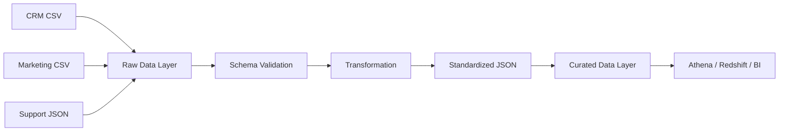
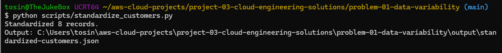
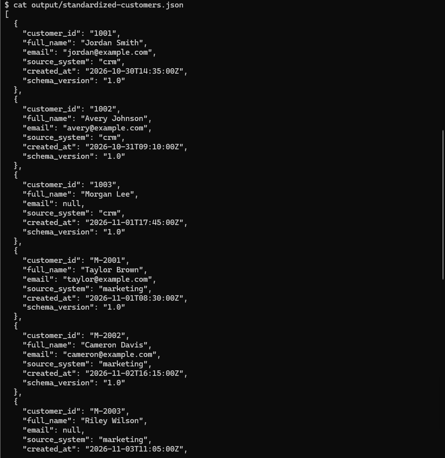

# Project 03 — Strategic Solutions for Cloud Engineering Challenges

## Status

**In progress.** This project focuses on solving common cloud engineering operational problems through practical design, automation, observability, documentation, and CI/CD improvements.

## Problem 1 — Data Source Variability

### Goal

Demonstrate how inconsistent source data can be standardized into a common schema before downstream analytics or applications consume it.

### Scenario

Three source teams provide customer data in different formats:

- CRM exports CSV with `customer_id`, `name`, and `created_at`
- Marketing exports CSV with different field names and date formatting
- Support emits JSON with nested/alternate naming

The transformation layer converts each source into one common record structure:

```json
{
  "customer_id": "string",
  "full_name": "string",
  "email": "string|null",
  "source_system": "string",
  "created_at": "ISO-8601 UTC",
  "schema_version": "1.0"
}
```

### Architecture



### Files

```text
problem-01-data-variability/
├── raw/
│   ├── crm_customers.csv
│   ├── marketing_customers.csv
│   └── support_customers.json
├── schema/
│   └── common-customer-schema.json
├── scripts/
│   ├── standardize_customers.py
│   └── validate_standardized.py
├── output/
│   ├── standardized-customers.json
│   └── data-quality-report.json
└── screenshots/
    ├── 01-data-standardization-success.png
    ├── 02-standardized-output.png
    └── 03-data-quality-validation-pass.png
```

### What This Demonstrates

- schema standardization
- data contracts
- source-to-target field mapping
- timestamp normalization
- null handling
- basic validation
- separating raw data from curated data
- designing a transformation step that could later be moved into AWS Glue

### AWS Mapping

A production AWS version could use:

```text
S3 Raw
  ↓
AWS Glue ETL
  ↓
Schema / Data Quality Validation
  ↓
S3 Curated (Parquet)
  ↓
Athena / Redshift / BI
```

The local Python exercise is intentionally small so the transformation logic can be understood before introducing managed AWS services.


## Problem 1 Evidence

### 1. Data Standardization Execution

I ran the local transformation script against three intentionally inconsistent source datasets. The script normalized field names, converted timestamps to ISO-8601 UTC, handled missing email values consistently, and produced a single standardized customer dataset.



### 2. Standardized Output

The transformed output demonstrates that records from different source systems now follow the same common structure: `customer_id`, `full_name`, `email`, `source_system`, `created_at`, and `schema_version`.



### 3. Data Quality Validation

After transformation, I ran a second validation script to verify required fields, valid source values, ISO-8601 UTC timestamps, schema versioning, duplicate IDs, and basic email formatting.

The validation result was:

```text
Records checked: 8
Valid records:   8
Invalid records: 0
Status:          PASS
```


This demonstrates a simple but realistic pipeline pattern:

```text
Different Source Formats
        ↓
Transformation
        ↓
Common Schema
        ↓
Data Quality Validation
        ↓
Trusted Curated Data
```

The same pattern could later be implemented with Amazon S3, AWS Glue ETL, Glue Data Quality, and a curated Parquet layer.
