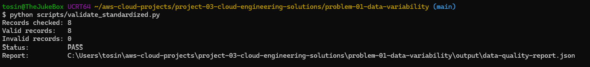
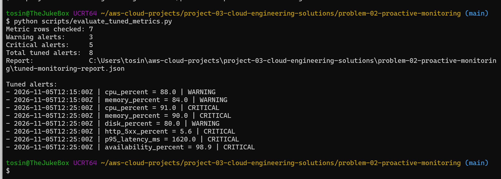
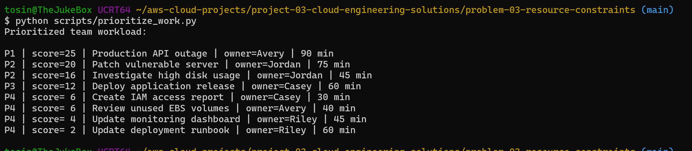

# Project 03 — Strategic Solutions for Cloud Engineering Challenges

## Status

**Completed.**

This project analyzes five common cloud engineering challenges and turns each one into a practical solution using lightweight automation, operational design, documentation, observability, and CI/CD practices.

The goal was not only to describe what a cloud team *should* do, but to build small working examples that demonstrate how those improvements can be implemented.

---

## Project Overview

| Problem | Solution Built | Key Outcome |
|---|---|---|
| Data source variability | Data transformation + validation pipeline | Standardized 8 records with 100% validation pass |
| Reactive monitoring | Threshold monitoring + alert tuning | Reduced alert volume from 20 to 8 |
| Resource constraints | Work prioritization + workload visibility | Highest-risk work surfaced first |
| Lack of documentation | Runbook + onboarding framework | Repeatable operational guidance |
| Limited CI/CD adoption | Local CI + GitHub Actions workflow | Automated validation completed successfully |

---

## Problem 1 — Data Source Variability

### Challenge

Different source systems can provide similar data using different field names, formats, timestamps, and null-handling rules. Without a common structure, downstream processing becomes brittle and difficult to maintain.

### Solution

I created three intentionally inconsistent source datasets and built a Python transformation workflow that converts them into a common customer schema.

The solution includes:

- source-to-target field mapping
- timestamp normalization to ISO-8601 UTC
- consistent null handling
- schema versioning
- required-field validation
- duplicate ID checks
- basic email validation

### Result

```text
Records checked: 8
Valid records:   8
Invalid records: 0
Status:          PASS
```



### AWS Mapping

A production implementation could use:

```text
Multiple Data Sources
        ↓
Amazon S3 Raw Layer
        ↓
AWS Glue ETL
        ↓
Schema / Data Quality Validation
        ↓
Amazon S3 Curated Layer
        ↓
Athena / Redshift / BI
```

[View Problem 1 details](problem-01-data-variability/)

---

## Problem 2 — Proactive Monitoring and Observability

### Challenge

Reactive teams often discover incidents only after users report them. This increases mean time to detect and can allow small issues to become larger outages.

### Solution

I created a monitoring exercise that evaluates:

- CPU utilization
- memory utilization
- disk utilization
- HTTP 5xx error rate
- p95 latency
- availability

The first monitoring pass generated alerts whenever a threshold was breached.

### Initial Result

```text
Metric rows checked: 7
Warning alerts:      10
Critical alerts:     10
Total alerts:        20
```

I then introduced alert tuning that required sustained unhealthy behavior before notifying the team.

### Tuned Result

| Measurement | Initial | Tuned |
|---|---:|---:|
| Warning alerts | 10 | 3 |
| Critical alerts | 10 | 5 |
| Total alerts | 20 | 8 |

This reduced alert volume by **60%** while preserving the important sustained critical conditions.



### Production Mapping

The same principles apply to platforms such as:

- Amazon CloudWatch
- Dynatrace
- Grafana
- Prometheus

[View Problem 2 details](problem-02-proactive-monitoring/)

---

## Problem 3 — Resource Constraints

### Challenge

Small cloud teams frequently handle incidents, deployments, access requests, maintenance, documentation, cost reviews, and monitoring at the same time.

Treating every request as equally urgent creates context switching and overload.

### Solution

I created an impact × urgency scoring model that assigns priorities from P1 to P4.

The highest-risk work correctly surfaced first:

```text
P1 | Production API outage
P2 | Patch vulnerable server
P2 | Investigate high disk usage
```



I also created a workload summary that makes each engineer's assigned effort visible and designed a cross-training model with primary and secondary ownership for critical systems.

### Recommendations

- reserve capacity for incidents and security work
- avoid scheduling engineers at 100% utilization
- maintain secondary owners for critical systems
- use shared operational runbooks
- automate repetitive, rule-based work
- regularly review workload distribution

[View Problem 3 details](problem-03-resource-constraints/)

---

## Problem 4 — Lack of Documentation and Guidance

### Challenge

Poor documentation increases onboarding time, creates dependence on individual engineers, and makes incident response inconsistent.

### Solution

I created a lightweight operational documentation framework containing:

- a reusable operational runbook template
- a four-week cloud engineer onboarding checklist
- an example high-CPU incident runbook
- ownership and review-date fields
- validation and rollback sections
- escalation guidance

### Documentation Lifecycle

```text
Create / Update
      ↓
Peer Review
      ↓
Publish
      ↓
Use During Real Work
      ↓
Capture Gaps
      ↓
Scheduled Review
      ↓
Update Again
```

The objective is to replace tribal knowledge with repeatable operational guidance.

[View Problem 4 details](problem-04-documentation-guidance/)

---

## Problem 5 — CI/CD Integration

### Challenge

Manual validation and deployment processes are slower, inconsistent, and more vulnerable to human error.

### Solution

I created a small CI workflow that performs:

- Python syntax validation
- deployment configuration validation
- application health-check validation
- GitHub-hosted automated execution

I first validated the pipeline locally:


Then I executed the same process through GitHub Actions:


### CI Flow

```text
Code Change
    ↓
Commit / Push
    ↓
GitHub Actions
    ↓
Automated Validation
    ↓
PASS / FAIL Feedback
```

This demonstrates a practical first step toward broader CI/CD adoption without attempting to automate production deployment immediately.

[View Problem 5 details](problem-05-cicd-integration/)

---

## Skills Demonstrated

This project demonstrates practical experience with:

- Python automation
- data transformation
- schema design
- data-quality validation
- monitoring strategy
- alert tuning
- operational prioritization
- workload analysis
- cross-training design
- runbook development
- onboarding documentation
- Git and GitHub
- GitHub Actions
- CI/CD design
- cloud operations strategy
- AWS architecture mapping

---

## Key Engineering Lessons

### 1. Standardization reduces downstream complexity

Keeping raw source data while transforming it into a common curated model provides consistency without forcing every source team to redesign its systems.

### 2. More alerts do not automatically mean better monitoring

An alert should represent something actionable. Tuning persistence and thresholds can significantly reduce alert fatigue.

### 3. Small teams need operational resilience

Prioritization, backup ownership, documentation, and automation reduce dependence on individual engineers.

### 4. Documentation is part of system reliability

A runbook is operational infrastructure. It makes procedures reproducible and helps engineers respond consistently.

### 5. CI/CD should be introduced incrementally

Starting with automated validation creates trust in the pipeline before introducing higher-risk deployment automation.

---

## Conclusion

This project demonstrates how I would approach cloud engineering challenges from both a technical and operational perspective.

Instead of treating data consistency, observability, staffing pressure, documentation, and CI/CD as isolated problems, I designed small solutions that improve reliability, repeatability, visibility, and team efficiency.

The overall approach is based on a simple principle:

> **Make operational work easier to understand, easier to repeat, easier to measure, and easier to automate.**
