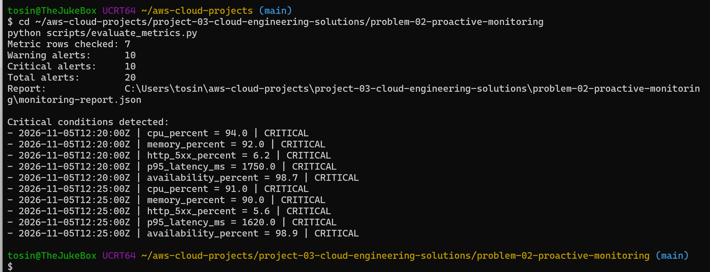

# Problem 02 — Proactive Monitoring and Observability

## Goal

Design a proactive monitoring approach that detects unhealthy behavior before users report an outage.

## Scenario

The current team mostly reacts after incidents are reported. That increases mean time to detect (MTTD), mean time to resolve (MTTR), and the chance that small issues become outages.

This exercise introduces a simple monitoring model built around:

- infrastructure metrics
- application metrics
- logs
- alert thresholds
- dashboards
- feedback and tuning

## Important Metrics

### Infrastructure

- CPU utilization
- memory utilization
- disk utilization
- network errors/retransmissions
- instance or node availability

### Application

- request rate
- error rate
- response time / latency
- availability
- dependency health

### Operational

- alert volume
- false-positive alerts
- MTTD
- MTTR
- repeated incidents

## Monitoring Strategy

A practical monitoring flow is:

```text
Systems / Applications
        ↓
Metrics + Logs
        ↓
Monitoring Platform
        ↓
Dashboards
        ↓
Threshold / Anomaly Alerts
        ↓
Incident Response
        ↓
Post-Incident Review
        ↓
Alert Tuning
```

## Alert Philosophy

Alerts should represent conditions that require action.

Examples:

| Metric | Warning | Critical |
|---|---:|---:|
| CPU | > 70% for 10 min | > 90% for 5 min |
| Memory | > 75% for 10 min | > 90% for 5 min |
| Disk | > 75% | > 90% |
| HTTP 5xx rate | > 2% | > 5% |
| p95 latency | > 750 ms | > 1500 ms |
| Availability | < 99.9% | < 99.0% |

These are example starting thresholds. In production, they should be tuned to the application's normal baseline and service-level objectives.

## Feedback Process

1. Review alerts weekly.
2. Identify alerts that did not require action.
3. Identify incidents that occurred without an alert.
4. Adjust thresholds or conditions.
5. Add missing telemetry.
6. Track MTTD and MTTR over time.

## Files

```text
problem-02-proactive-monitoring/
├── README.md
├── config/
│   └── alert-rules.json
├── examples/
│   └── sample-metrics.csv
└── scripts/
    └── evaluate_metrics.py
```


## Evidence

### Initial Alert Detection

I ran the monitoring evaluator against seven metric samples representing a system that gradually became unhealthy.

The first pass generated:

```text
Metric rows checked: 7
Warning alerts:      10
Critical alerts:     10
Total alerts:        20
```

The evaluator correctly identified severe conditions including high CPU, high memory usage, elevated HTTP 5xx errors, increased p95 latency, and reduced availability.



This demonstrates proactive detection, but it also exposes a second operational problem: **alert noise**. If every bad sample produces another alert, engineers can receive many repeated notifications for the same incident.

## Alert Tuning Exercise

The next step is to reduce alert fatigue by requiring the same severity to be present in two consecutive metric samples before an alert is generated.

This changes the behavior from:

```text
One bad sample
    ↓
Immediate alert
```

to:

```text
First bad sample
    ↓
Observe
    ↓
Second consecutive bad sample
    ↓
Actionable alert
```

The tuned evaluator also emits alerts only when a metric enters a new sustained severity state, preventing repeated notifications for the same condition.
