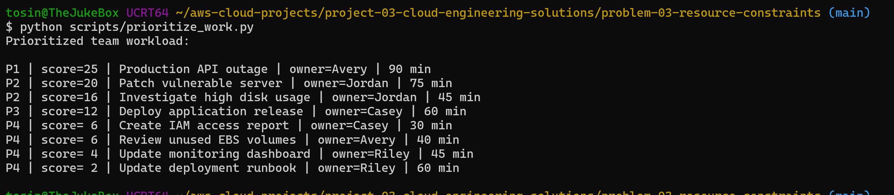
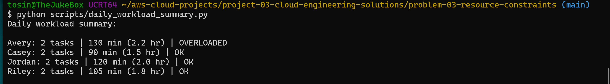

# Problem 03 — Resource Constraints

## Goal

Design practical ways for a small cloud engineering team to handle competing priorities, reduce single points of failure, and automate repetitive work.

## Scenario

A small cloud team is responsible for incidents, monitoring, deployments, access requests, maintenance, documentation, and cloud cost reviews. When several tasks arrive at the same time, engineers can become overloaded and critical work can be delayed.

This exercise focuses on three improvements:

- workload prioritization
- cross-training and coverage
- automation of repetitive tasks

## 1. Workload Assessment

Typical work for a small cloud team may include:

| Work Type | Example | Risk if Delayed |
|---|---|---|
| Production incident | Application unavailable | Critical |
| Security issue | Exposed credential | Critical |
| Monitoring alert | High CPU / disk | High |
| Deployment request | Application release | Medium |
| Access request | IAM permission change | Medium |
| Documentation | Runbook update | Low |
| Cost review | Unused resources | Medium |

A common problem is treating every request as equally urgent. That causes context switching and makes it harder to protect time for high-impact work.

## 2. Prioritization Model

I use a simple impact/urgency model:

| Priority | Description |
|---|---|
| P1 | Critical production or security impact; immediate response |
| P2 | High operational impact; same-day response |
| P3 | Normal planned work; schedule into available capacity |
| P4 | Low-risk maintenance or improvement work |

The included prioritization script scores sample tasks using impact and urgency so the team can work from highest to lowest risk.

## 3. Cross-Training and Coverage

A small team becomes fragile when only one person knows a system.

Example coverage model:

| Area | Primary | Secondary |
|---|---|---|
| AWS / Infrastructure | Engineer A | Engineer B |
| Monitoring / Observability | Engineer B | Engineer C |
| CI/CD | Engineer C | Engineer A |
| IAM / Access | Engineer A | Engineer C |
| Documentation / Runbooks | Shared | Shared |

The goal is not for everyone to be an expert in everything. The goal is to make sure there is at least one backup for critical responsibilities.

## 4. Automation Opportunities

Good automation targets are repetitive, rule-based tasks with low ambiguity.

Examples:

- daily resource health checks
- stale EC2/EBS discovery
- standard IAM access reports
- log cleanup
- ticket creation from alerts
- scheduled backup verification
- environment inventory collection

The sample automation in this folder generates a daily workload summary from a CSV task queue.

## Files

```text
problem-03-resource-constraints/
├── README.md
├── examples/
│   └── team-workload.csv
├── config/
│   └── team-coverage.json
└── scripts/
    ├── prioritize_work.py
    └── daily_workload_summary.py
```

## Desired Outcomes

- reduce context switching
- protect response time for critical work
- improve backup coverage
- reduce repetitive manual effort
- make workload visible to the whole team


## Evidence

### Workload Prioritization

I used an impact × urgency scoring model to rank competing cloud engineering tasks.

The highest-priority work correctly surfaced first:

- **P1:** Production API outage
- **P2:** Patch vulnerable server
- **P2:** Investigate high disk usage

Lower-risk work such as documentation and dashboard updates was placed at a lower priority.



This helps a small team avoid treating every request as equally urgent and reduces unnecessary context switching.

### Team Workload Analysis

I also summarized each engineer's assigned work in minutes and hours to identify where workload may be uneven.



The purpose is not to perfectly predict effort. It is to create visibility so the team can rebalance work before one engineer becomes a bottleneck.

## Resource Management Recommendations

### 1. Protect Capacity for High-Priority Work

I would reserve part of the team's daily capacity for incidents, security issues, and urgent operational work instead of scheduling every engineer at 100% utilization.

### 2. Cross-Train Critical Responsibilities

Each critical area should have a primary and secondary owner.

This reduces the risk that one engineer becomes a single point of failure and makes vacation, illness, and incident coverage easier.

### 3. Use Shared Runbooks

Runbooks should document repeatable operational procedures so secondary owners can safely perform tasks without relying on tribal knowledge.

### 4. Automate Repetitive Work

The strongest automation candidates are repetitive tasks with clear decision rules, such as:

- health checks
- cloud inventory collection
- stale resource discovery
- IAM reporting
- backup verification
- ticket creation from alerts
- scheduled cost reviews

The included `daily_workload_summary.py` script is a small example of this principle: instead of manually totaling work by engineer, the script produces the workload summary automatically.

## Problem 3 Outcome

This exercise demonstrates that resource constraints are not solved only by adding headcount.

A small cloud team can improve resilience by:

- prioritizing work based on impact and urgency
- making workload visible
- maintaining secondary ownership for critical systems
- documenting operational procedures
- automating repetitive tasks
- reviewing capacity before overload becomes an incident

These practices reduce context switching, improve coverage, and allow engineers to spend more time on high-value engineering work.
