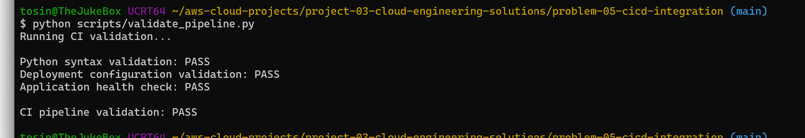
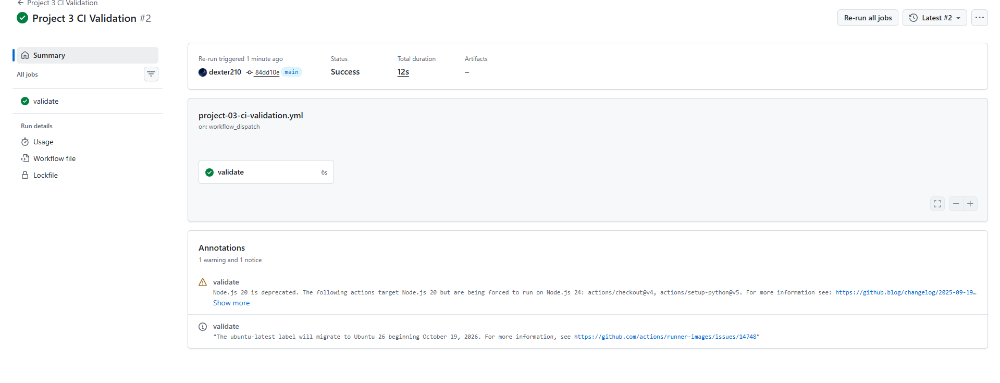

# Problem 05 — Integration of CI/CD Practices

## Goal

Demonstrate how a small cloud team can introduce CI/CD gradually to make changes safer, faster, and more repeatable.

## Problem

Without CI/CD, teams often rely on manual steps for testing, validation, and deployment.

That creates several risks:

- inconsistent deployment steps
- missed validation checks
- slower releases
- harder rollbacks
- configuration drift
- more human error

## CI/CD Strategy

A good adoption plan should start small.

Instead of automating an entire production deployment on day one, I would begin with a pilot workflow that validates code whenever changes are pushed.

The workflow in this exercise performs:

1. Python syntax validation
2. project script execution
3. JSON configuration validation
4. basic deployment artifact checks

## CI/CD Flow

```text
Developer Changes Code
        ↓
git add / commit
        ↓
git push
        ↓
GitHub Actions
        ↓
Automated Validation
        ↓
PASS → Change is safer to merge
FAIL → Fix before deployment
```

## Why This Helps

CI/CD improves consistency because the same checks run every time.

It also creates fast feedback. Engineers do not have to remember every validation command manually.

## Implementation Strategy

### Phase 1 — Continuous Integration

Start with:

- syntax checks
- automated tests
- configuration validation
- security scanning
- linting

### Phase 2 — Controlled Delivery

Then add:

- artifact packaging
- staging deployment
- approval gates
- rollback validation

### Phase 3 — Production Automation

Only after the team trusts the process should production deployment become more automated.

## Challenges

Common adoption challenges include:

- resistance to changing established workflows
- poorly documented deployment steps
- missing automated tests
- secrets management
- unclear ownership
- pipelines that become too complicated

The best approach is to start with one small service or project, demonstrate value, and expand from there.

## Files

```text
problem-05-cicd-integration/
├── README.md
├── app/
│   └── health_check.py
├── config/
│   └── deployment-config.json
├── scripts/
│   └── validate_pipeline.py
└── screenshots/
    ├── 01-local-ci-validation-pass.png
    └── 02-github-actions-ci-pass.png

Repository root:
.github/
└── workflows/
    └── project-03-ci-validation.yml
```

## Desired Outcomes

- reduce manual validation
- catch problems before deployment
- make releases repeatable
- provide fast feedback
- create a foundation for future automated delivery


## Evidence

### Local CI Validation

Before relying on the hosted workflow, I ran the validation script locally to confirm the same checks passed on my workstation.

The local validation confirmed:

- Python syntax validation passed
- deployment configuration validation passed
- application health check passed
- the overall CI validation passed



### GitHub Actions CI Validation

I triggered the CI workflow from GitHub Actions using the `main` branch.

The hosted runner completed the `validate` job successfully, proving that the validation process works outside my local machine and can be executed consistently by the repository.



The workflow checks out the repository, configures Python, and runs the same validation script used locally.

## Problem 5 Outcome

This exercise demonstrates a practical first step toward CI/CD adoption:

```text
Code Change
   ↓
Push / Pull Request
   ↓
GitHub Actions
   ↓
Automated Validation
   ↓
PASS or FAIL Feedback
```

The main benefit is repeatability. Instead of relying on an engineer to remember every validation step, the repository performs the checks automatically.

A production version could later add:

- unit and integration tests
- security scanning
- container image builds
- artifact publishing
- staging deployment
- approval gates
- production deployment
- automated rollback
