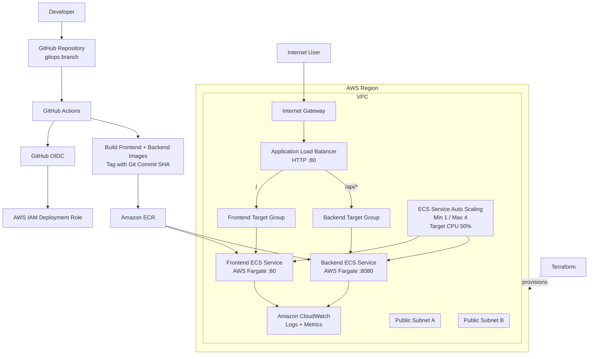

# Project 04 — GitOps Deployment to Amazon ECS Fargate

## Overview

This project demonstrates a complete containerized deployment workflow for a React frontend and Express/Node.js backend on AWS.

The environment was provisioned with Terraform, container images were stored in Amazon ECR, application services ran on Amazon ECS with AWS Fargate, and traffic was routed through an Application Load Balancer. GitHub Actions provided the CI/CD workflow, with GitHub OIDC used for short-lived AWS authentication instead of long-lived access keys.

**Status:** completed.

## What I Built

- React frontend served by Nginx
- Express/Node.js backend API
- Separate frontend and backend Docker images
- Amazon ECR repositories for private image storage
- Amazon ECS cluster using AWS Fargate
- Frontend ECS service on port 80
- Backend ECS service on port 8080
- Internet-facing Application Load Balancer
- Path-based routing for `/` and `/api/*`
- CloudWatch container logging and service metrics
- ECS Service Auto Scaling using CPU target tracking
- GitHub Actions deployment workflow
- GitHub OIDC authentication to AWS
- Terraform-managed AWS application infrastructure

## Architecture



## GitOps Deployment Flow

Each push to the `gitops` branch triggered the deployment workflow:

1. Check out the repository.
2. Request a GitHub OIDC token.
3. Assume an AWS IAM deployment role.
4. Authenticate to Amazon ECR.
5. Build the frontend and backend Docker images.
6. Tag both images with the Git commit SHA.
7. Push the images to ECR.
8. Read the current ECS task definitions.
9. Register new task definition revisions with the new image tags.
10. Update both ECS services.
11. Wait for both services to reach a stable state.

This design avoided storing long-lived AWS access keys in GitHub.

## Infrastructure as Code

Terraform was divided by responsibility:

- `networking.tf` — VPC, public subnets, Internet Gateway, route table
- `security-groups.tf` — ALB and ECS security groups
- `ecr.tf` — container repositories
- `alb.tf` — ALB, target groups, listener, path routing
- `ecs.tf` — cluster, task definitions, and ECS services
- `iam.tf` — ECS task execution role
- `cloudwatch.tf` — container log groups
- `autoscaling.tf` — ECS Service Auto Scaling
- `outputs.tf` — deployment outputs

## Security Decisions

- GitHub Actions used OIDC for temporary AWS credentials.
- The CI/CD role was scoped to required ECR, ECS, and role-passing actions.
- ECS application ports accepted inbound traffic only from the ALB security group.
- The ALB was the public entry point for application traffic.
- Terraform state and local provider cache files were excluded from source control.
- No AWS access keys, secret keys, session tokens, private keys, or application credentials are included in this public portfolio documentation.
- Account-specific identifiers and live submission endpoints have been intentionally replaced with generic descriptions.

## Auto Scaling Validation

Both ECS services used target-tracking scaling:

```text
Minimum tasks: 1
Maximum tasks: 4
Metric: ECSServiceAverageCPUUtilization
Target CPU: 50%
Scale-out cooldown: 60 seconds
Scale-in cooldown: 60 seconds
```

During load testing, the backend service demonstrated:

```text
1 running task
      ↓
CPU load increased
      ↓
2 running tasks
      ↓
4 running tasks
      ↓
Load stopped
      ↓
1 running task
```

This validated both scale-out and scale-in behavior.

## Troubleshooting Example

The first ECS frontend deployment failed because the Nginx configuration referenced a Docker-local backend hostname.

That hostname worked on the local Docker network but was not resolvable between separate ECS Fargate tasks.

CloudWatch logs exposed the error:

```text
host not found in upstream "devops-backend"
```

I corrected the architecture by removing the Docker-local reverse proxy from the frontend container and moving production API routing to the Application Load Balancer:

```text
/       → frontend target group
/api/*  → backend target group
```

After the change, both ECS services reached a healthy state.

## Validation Performed

The project was validated at multiple layers:

- frontend and backend ran locally
- Docker images built successfully
- containers communicated locally
- Terraform validation and plan succeeded
- ECR images were pushed successfully
- ECS task definitions and services became active
- ALB target groups reported healthy targets
- frontend returned HTTP 200
- backend API returned HTTP 200 with JSON data
- CPU load triggered ECS scale-out
- service later returned to minimum capacity
- GitHub OIDC authentication succeeded
- GitHub Actions completed an end-to-end ECS deployment successfully

## Technologies

**AWS:** ECS, Fargate, ECR, Application Load Balancer, VPC, IAM, CloudWatch, Application Auto Scaling  
**DevOps:** Docker, Terraform, GitHub Actions, GitHub OIDC, Git  
**Application:** React, Node.js, Express, Nginx

## Portfolio Note

The original challenge repository remains private during the review process. This public portfolio entry is intentionally sanitized: reviewer information, AWS account identifiers, temporary endpoints, and submission-only details are not included.

## Key Takeaways

This project strengthened my understanding of:

- separating local container networking from cloud-native routing
- building repeatable AWS infrastructure with Terraform
- using Fargate for serverless container execution
- using ALB path-based routing for multi-service applications
- debugging container failures with CloudWatch logs
- validating horizontal scaling under real load
- building traceable deployments with commit-SHA image tags
- using OIDC instead of long-lived cloud credentials
- treating cleanup, cost awareness, observability, and security as part of the deployment lifecycle
