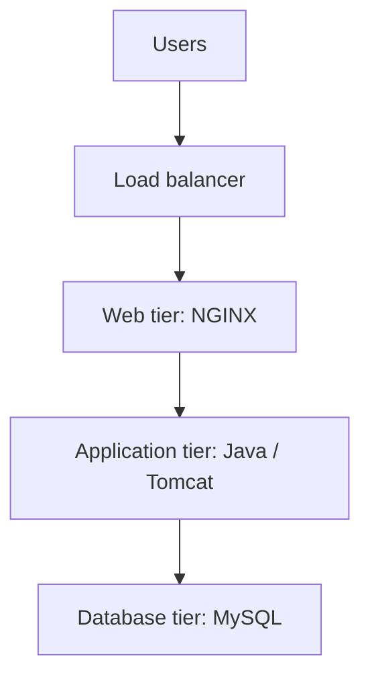

# Architecture

This is the planned three-tier design. The deployment and its final AWS configuration still need to be validated.

## Application files

The [Java login application](Java-Login-App/) includes the source code, Maven configuration, and application pages. The [reference guide](REFERENCE_GUIDE.md) contains the starting architecture and deployment instructions.

## Project workflow

1. Plan networking, access, and estimated AWS costs.
2. Build the application and deploy the web, application, and database tiers.
3. Validate connectivity, application functionality, and monitoring.
4. Document the configuration, troubleshooting, and cleanup.

**Status:** Setup in progress.
